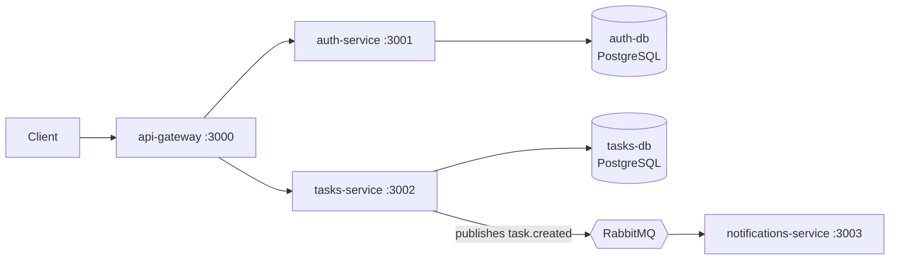

# TaskFlow

A task management platform built as a **microservices** system, containerized with
**Docker** and shipped through a **CI/CD** pipeline on GitHub Actions.


## Architecture



| Service | Stack | Responsibility |
|---|---|---|
| `api-gateway` | Node.js, Express | Single entry point: JWT validation, rate limiting, routing |
| `auth-service` | Node.js, Express, PostgreSQL | Registration, login, JWT issuing (bcrypt-hashed passwords) |
| `tasks-service` | C#, .NET 10, EF Core, PostgreSQL | Task CRUD scoped to the authenticated user |
| `notifications-service` | Node.js, RabbitMQ | Consumes task events and simulates email notifications |

### Design decisions

- **Database per service.** Each service owns its data; no shared tables.
- **Async messaging.** `tasks-service` publishes events to a RabbitMQ fanout exchange, so a
  notifications outage never blocks task creation.
- **Trust boundary at the gateway.** The gateway validates the JWT and forwards the user id
  in the `x-user-id` header. Internal services are not published to the host, so they can
  only be reached through the gateway.
- **Object-level authorization.** Every task query filters by both task id and owner id,
  and returns `404` for tasks that belong to someone else.

## Getting started

### Prerequisites

- Docker Desktop
- (Optional, for local development) Node.js 20+ and .NET SDK 10

### Run everything

```bash
git clone https://github.com/alancisneros98/taskflow.git
cd taskflow

cp .env.example .env        # Windows: copy .env.example .env
# edit .env and set real values (generate JWT_SECRET with:
#   node -e "console.log(require('crypto').randomBytes(32).toString('hex'))")

docker compose up --build
```

The API is available at `http://localhost:3000`. RabbitMQ's management UI is at
`http://localhost:15672`.

### Try it

```bash
# Register
curl -X POST http://localhost:3000/api/auth/register \
  -H "Content-Type: application/json" \
  -d '{"name":"Juan","email":"juan@test.com","password":"123456"}'

# Create a task (use the token from the response)
curl -X POST http://localhost:3000/api/tasks \
  -H "Content-Type: application/json" \
  -H "Authorization: Bearer <token>" \
  -d '{"title":"Learn Docker","description":"Finish TaskFlow"}'
```

## API

All routes go through the gateway at `http://localhost:3000`.

| Method | Route | Auth | Description |
|---|---|---|---|
| POST | `/api/auth/register` | No | Create a user, returns a JWT |
| POST | `/api/auth/login` | No | Log in, returns a JWT |
| GET | `/api/tasks` | Yes | List your tasks |
| GET | `/api/tasks/:id` | Yes | Get one of your tasks |
| POST | `/api/tasks` | Yes | Create a task |
| PUT | `/api/tasks/:id` | Yes | Update a task |
| DELETE | `/api/tasks/:id` | Yes | Delete a task |

## CI/CD

Every push and pull request runs the pipeline in `.github/workflows/ci.yml`:

1. **Test auth-service** — Jest + supertest against a PostgreSQL service container
2. **Test tasks-service** — xUnit (runs in parallel with the job above)
3. **Build & push** — only on `main` and only if tests pass; builds the four Docker
   images and publishes them to GitHub Container Registry, tagged with `latest` and the
   commit SHA

## Project structure

```
taskflow/
├── api-gateway/
├── auth-service/
├── tasks-service/
├── notifications-service/
├── .github/workflows/ci.yml
├── docker-compose.yml
└── .env.example
```
